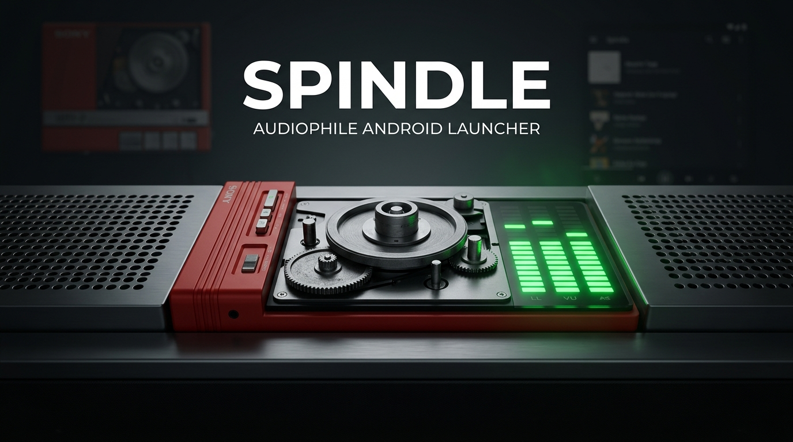
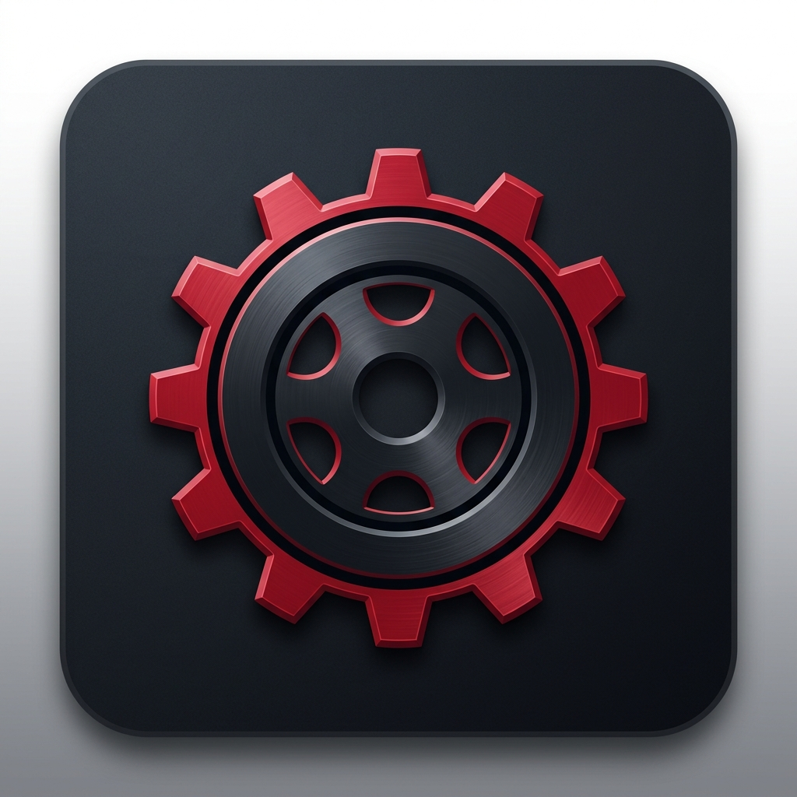
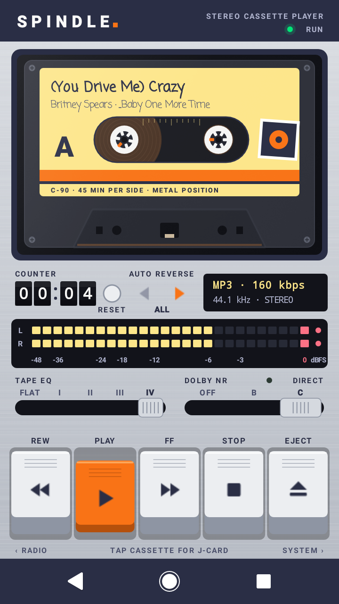
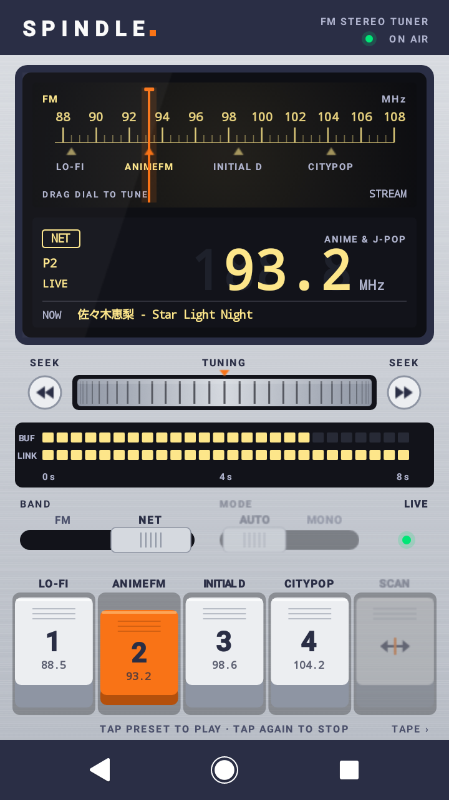
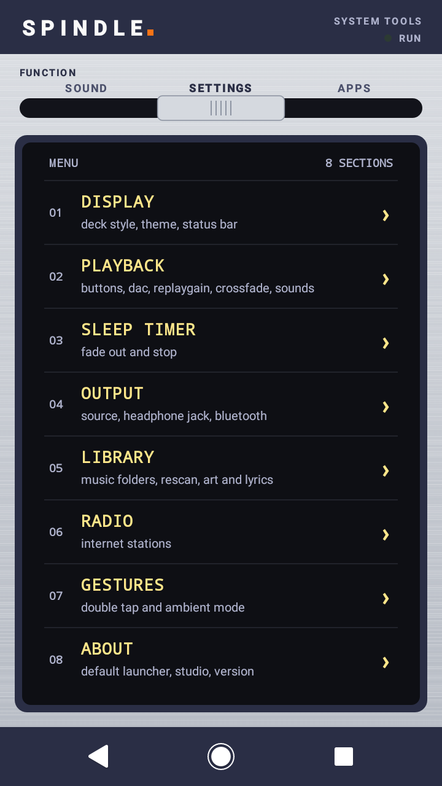

<div align="center">

  

  <br/><br/>

  

  <h1>Spindle</h1>
  <p><b>Give your old Android phone a second life as a retro cassette player.</b></p>
  <p>Turn that dusty phone in your drawer into a distraction-free music player. 100% offline, zero ads, no subscriptions, and pure tape nostalgia.</p>

  <br/>

  <p>
    <a href="#-choose-your-flavor"></a>
    <a href="https://paypal.me/manaphassan"></a>
  </p>

  <br/>

  <p>
    <a href="#-choose-your-flavor">Downloads</a>
    <span> · </span>
    <a href="#-features-youll-love">Features</a>
    <span> · </span>
    <a href="#-how-to-install-in-3-steps">Quick Start</a>
    <span> · </span>
    <a href="https://manaphassan.github.io/Spindle/">Website</a>
    <span> · </span>
    <a href="#-support-the-project">Support</a>
    <span> · </span>
    <a href="MASTER_DOCUMENTATION.md">Tech Specs</a>
  </p>

</div>

---

> [!NOTE]
> **💬 A Quick Note from the Creator:**  
> Hey there! I'm not a big corporate dev team or professional programmer—just someone who loves music, misses the tactile feel of cassettes, and wanted to rescue old phones from landfills. This is a personal passion project shared freely with fellow music lovers. Please use it **"as is"**, have fun with it, and enjoy the retro vibes!

---

## 📥 Choose Your Flavor

Spindle comes in two editions so you get the smoothest experience on whatever device you have:

| Edition | Best For... | What You Get | Download |
| :--- | :--- | :--- | :---: |
| **Spindle Standard**<br/>`v1.7.2-STUDIO` | **Modern phones & newer DAPs**<br/>Android 8.0 or newer | • Faceplate cassette deck (Silver '81 / Pro Black) or the classic animated vertical deck<br/>• Faceplate FM / internet radio with buffer and link meters<br/>• Real output VU & LED meters<br/>• 10-band EQ, software parametric EQ with AutoEq import, tape & Dolby emulation<br/>• Bit-perfect mixer mode & DSD over PCM (Android 14+, USB / wired DAC)<br/>• FLAC, WavPack, DSD (.dsf/.dff), AIFF, MP3, AAC, Ogg / Opus<br/>• Synchronized lyrics with LRCLIB auto-download | [**Download v1.7.2 APK**](https://github.com/manaphassan/Spindle/releases/download/v1.7.2-STUDIO/Spindle-Standard-v1.7.2-STUDIO-release.apk)<br/><sub>Size: 4.6 MB · signed release</sub><br/><sub>[Release notes & checksums](https://github.com/manaphassan/Spindle/releases/tag/v1.7.2-STUDIO)</sub> |
| **Spindle Lite**<br/>`v1.1.1-LITE` | **Vintage phones & compact players**<br/>Android 4.4 (KitKat) down to 4.1<br/>Tiny 3-inch screens & 512MB RAM | • Super lightweight — sips battery & uses almost zero RAM<br/>• Zune HD Metro layout, typography & 5-pivot Vault (`songs`, `artists`, `albums`, `folders`, `queue`)<br/>• Zune 26-letter quick jump grid (A–Z)<br/>• Artists & Albums drill-down with Play All<br/>• 3-digit mechanical tape counter & Type IV/II/I cassette skins<br/>• Full physical button control (camera shutter, volume, d-pad)<br/>• Blazing fast on decade-old hardware | [**Download APK**](release_package/latest/Spindle-Lite-v1.1.1-LITE.apk)<br/><sub>Size: 1.73 MB</sub><br/><sub>[Release Package](release_package/latest/)</sub> |

> 💡 **Not sure which one to pick?**  
> If your phone was made in the last 6–8 years, grab **Spindle Standard**.  
> If you're reviving an old phone from 2011–2014 (like an Xperia active, Galaxy S3, or low-RAM player), grab **Spindle Lite**.  
> Standard v1.7.2 updates v1.6.0 and later in place (same signing key). v1.7.0 and later also fix a Studio unlock weakness in v1.6.0, so please update.  
> Checksums: Standard on the [release page](https://github.com/manaphassan/Spindle/releases/tag/v1.7.2-STUDIO), Lite in [`release_package/latest/`](release_package/latest/).

---

## 📸 Snapshots

<div align="center">
  <table>
    <tr>
      <td width="33%" align="center">
        <b>Faceplate Deck</b><br/>
        <sub>Real level meter, tape EQ & Dolby sliders</sub><br/><br/>
        
      </td>
      <td width="33%" align="center">
        <b>Faceplate Radio</b><br/>
        <sub>FM & internet streams with buffer meter</sub><br/><br/>
        
      </td>
      <td width="33%" align="center">
        <b>System Deck</b><br/>
        <sub>Sound, settings & apps behind one switch</sub><br/><br/>
        
      </td>
    </tr>
  </table>
  <sub>v1.7 faceplate deck style. The classic deck below is still one tap away in Settings › Display.</sub>
  <br/><br/>
  <table>
    <tr>
      <td width="50%" align="center">
        <b>Cassette Tape Deck</b><br/>
        <sub>Watch the reels turn and tape advance</sub><br/><br/>
        
      </td>
      <td width="50%" align="center">
        <b>Lock Screen Player</b><br/>
        <sub>Full tape controls right on your lock screen</sub><br/><br/>
        
      </td>
    </tr>
    <tr>
      <td width="50%" align="center">
        <b>Now Playing & Lyrics</b><br/>
        <sub>Circular album art, live visualizer & synced lyrics</sub><br/><br/>
        
      </td>
      <td width="50%" align="center">
        <b>Music Library</b><br/>
        <sub>Fast A-Z index, folder browsing & instant search</sub><br/><br/>
        
      </td>
    </tr>
    <tr>
      <td width="50%" align="center">
        <b>FM & Online Radio</b><br/>
        <sub>Flywheel tuning dial with signal meter</sub><br/><br/>
        
      </td>
      <td width="50%" align="center">
        <b>Sound Equalizer</b><br/>
        <sub>Dual dancing VU needles & 10-band tone control</sub><br/><br/>
        
      </td>
    </tr>
  </table>
</div>

---

## ✨ Features You'll Love

- 📼 **Real Tape Action**: Watch the tape reels spin as your music plays. Fast-forward and rewind speed up the spools just like real magnetic tape.
- 🎛️ **Two Deck Styles**: Pick the painted faceplate deck (Silver '81 or Pro Black) or the classic vertical deck. The radio and system drawer follow your choice.
- 📊 **Meters That Mean It**: The VU and LED meters read the real audio output, so they move with what you hear.
- 📴 **100% Offline & Distraction-Free**: Put your phone on airplane mode, plug in your favorite wired headphones, and escape the internet. No accounts, no logins, no notifications, and zero tracking.
- 🚫 **Forever Free, Zero Ads**: No annoying banner ads interrupting your album, no popups, no subscriptions, and no paywalls. Ever.
- ⚡ **Light as a Feather**: Opens in a flash, sips battery, and won't bog down your device.
- 🎛️ **Clicky Real Buttons**: Keep your screen off and your phone in your pocket! Change tracks and adjust volume using your physical volume rocker, camera shutter key, or wired headphone remote.
- 📁 **Your Music, Your Folders**: If you organize your albums in folders on your SD card, you'll feel right at home with direct folder browsing, fast A-Z jumping, and instant search. Swapped or removed your SD card? Spindle notices and offers to rescan, and keeps your tracks if the card is just out.
- 📻 **Analog Radio Fun**: Spin the virtual tuning flywheel to dial in FM radio stations (your wired headphone cable is the antenna) or listen to curated online streams.
- 📼 **Mixtapes & .M3U Portability**: Craft custom mixtape playlists with drag-and-drop track reordering, export standard `.m3u8` playlists, and import existing libraries effortlessly.
- 🎚️ **Audiophile Engine & Extended Formats**: 32-bit float PCM pipeline with a soft-knee limiter, FLAC, WavPack, native DSD (DSF/DFF) decimation, AIFF, 10-band ISO EQ plus a software parametric EQ with AutoEq import and reference headphone profiles, bit-perfect mixer mode and DSD over PCM on Android 14+ (shown as verified only when the platform confirms it), 89 dB ReplayGain, and equal-power crossfade.

---

## 🚀 How to Install in 3 Steps

Getting started takes less than a minute:

1. **Download the APK** — Tap the download button above on your Android phone or music player.
2. **Tap & Install** — Open the downloaded file from your notifications or Downloads folder. *(If your phone asks for permission to install, just tap "Settings" and turn on "Allow from this source".)*
3. **Press Play & Enjoy** — Open Spindle, grant storage access so it can find your songs, and watch the tape roll!

> 💡 **Dedicated Player Tip:** Want to turn an old phone into a dedicated music machine? In your Android Settings, go to *Default Apps → Home app* and set **Spindle** as your default home screen. Every time you press the Home button, you'll go straight back to your cassette deck!

> 🔄 **Updating from v1.6.0 or v1.7.x?** Install the new APK over the old one. Your library, mixtapes and settings stay. The new faceplate deck becomes the default home deck; switch back in *Settings › Display › Home Deck Style*.

---

## 💖 Support the Project

Spindle is made by **HaNa Innovation** as a pure passion project. There are no venture capitalists, no ads, and no user tracking.

If Spindle helped you rescue an old device from the junk drawer or simply brought back the fun of listening to full albums, consider tossing a few bucks into the tip jar. Your support helps buy vintage test devices and keeps classic hardware out of landfills:

<div align="center">
  <p>
    <a href="https://paypal.me/manaphassan">
      
    </a>
  </p>
  <p><b>Direct Link:</b> <a href="https://paypal.me/manaphassan">https://paypal.me/manaphassan</a></p>
  <sub>Every little bit helps keep old hardware alive. Thank you for listening!</sub>
</div>

---

## 🛠️ For Developers & Tinkerers

Want to poke around under the hood, build from source, or check out the audio engine specs?

- **[Master Technical Documentation](MASTER_DOCUMENTATION.md)** — Architecture, audio pipeline, and roadmap.
- **[Contributing Guide](CONTRIBUTING.md)** — Module rules, naming, review checklist, CI and releases.
- **[Canonical Glossary](docs/GLOSSARY.md)** — One name per concept across code, UI and docs.
- **Release notes: [v1.7.2](RELEASE_NOTES_v1.7.2-STUDIO.md) · [v1.7.1](RELEASE_NOTES_v1.7.1-STUDIO.md) · [v1.7.0](RELEASE_NOTES_v1.7.0-STUDIO.md)** — What changed in the current releases.
- **[Spindle Lite Master Documentation](docs/SPINDLE_LITE_MASTER_DOCUMENTATION.md)** — Hardware key dispatch matrix and memory optimization specs.
- **[Brand & Design Guide](docs/BRANDING.md)** — Typography, colors, and design standards.

---

## 🛡️ License

Spindle is free and open-source software licensed under the **[PolyForm Noncommercial License 1.0.0](LICENSE)**.

```
Copyright (c) 2026 HaNa Innovation

Licensed under the PolyForm Noncommercial License 1.0.0.
Free to use, inspect, modify, and distribute for any non-commercial purpose.
Commercial sale, paid distribution, or monetization is strictly prohibited.
```

<div align="center">
  <sub>Made with ❤️ for analog lovers and classic gadget tinkerers.</sub>
</div>
